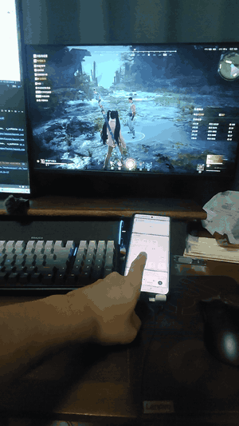

# PhoneKB · 手机键盘

**给 Codex 派完活，就可以接着刷手机了。**

我经常给 Codex 发个任务，然后拿起手机刷一会儿。等我想起来抬头看一眼，电脑上还停着一个「确认」窗口，Codex 正等我点一下。明明只差这一下，还得先把手机放下，再伸手去摸鼠标。

后来我想，手机都在手里了，干脆就在手机上点吧。于是做了 PhoneKB，给自己备了个懒人遥控器。用手指在屏幕上挪鼠标、点确认，想按回车或按组合键，就点面板上的按钮。打开 **Codex Micro**，手机上点一下就能让电脑打开一个新任务，还能看六个任务槽的颜色，知道哪个还在跑、哪个在等我回复。

PhoneKB 是一套把 **安卓手机变成 Codex 控制键盘和 Windows 自定义控制面板**的开源工具。手机竖着用，可以在几页快捷键和触控板之间切换。进入横屏手柄后，可以把按钮和摇杆摆到拇指顺手的位置。

[项目实机介绍视频（MP4，4 分 52 秒，可下载观看）](https://github.com/min2577/phonekb/blob/demo-2026-11-21/phonekb-project-demo.mp4)

> **源码预览版。** 目前需要自行从源码运行，适合想试用或继续开发的人。

## 项目亮点

### Codex Micro · 手机上的 Codex 键盘

- **一键在电脑上新建任务**。点手机上的「＋／新任务」键，Windows 上的 Codex Desktop 会打开一个空白任务。写好内容后，可以用手机的回车键提交电脑输入框里的文字。
- **六个任务槽**。长按槽位，把电脑当前打开的 Codex 任务绑进去。之后点对应槽位就能让电脑跳回那个任务。已绑的槽位还可以改名、重新绑定或解除绑定。
- **用颜色看状态**。任务键的底色、指示灯和状态文字一起变化。蓝色表示启动或运行，橙黄色表示待输入，绿色表示完成，紫色表示待确认，红色表示错误，灰色表示已停止。
- **从手机发任务和续聊**。打开手机面板的任务编辑框，可以选推理强度、输入任务内容，再交给电脑上的 Codex 命令行执行。已有会话可以接着发后续要求。
- **提醒和确认**。手机收到待输入、待确认、完成、失败或停止的状态后，可以发出本地通知。当前槽位绑定了对应任务，且桌面端能识别它的终端操作确认时，可以在手机上选择「允许一次」或「拒绝」。通知依赖连接、应用收到事件及系统权限。
- **功能键可以改**。可以把常用位置设为新任务、回车、刷新、停止任务或按住说话等操作。语音键的实际用法见下文。

桌面任务的新建、跳转和确认依赖 Windows 上已配置的 Codex Desktop 及其界面版本。从手机编辑框发送任务使用电脑上的 Codex 命令行。 [手机面板](android-app/components/PanelCodexMicro.vue) · [功能键配置](android-app/utils/codexMicroConfig.js) · [Windows 接入](desktop/codex_bridge.py)

### 横屏做一块自己的手柄

- **位置和大小**。在手机的「自定义手柄」里添加、拖动、放大、缩小或复制按钮。常用的做大一点，偶尔才用的放到边上。
- **功能和样式**。可以给按钮改名字、绑单键或组合键，选圆形、方形或胶囊等形状，也可以调颜色和透明度。常用的按钮可以存成预设，在另一个布局里继续用。
- **摇杆和方向键**。Windows 端的手柄编辑器还可以添加摇杆、十字方向键、ABXY、肩键和鼠标区域。比如把左摇杆绑成 `WASD`，用右摇杆移动视角。手柄通过键盘和鼠标输入来控制电脑，布局通过 Wi-Fi 同步。

### 把常用操作做成快捷键面板

点空格添加按键，长按拖动换位。一个按钮可以发出组合键、鼠标操作或固定文本。也可以从 VS Code、Office、OBS 等预设开始，按自己的操作习惯修改。部分预设需要在电脑上的软件里先设置对应快捷键。

**把多个快捷键编成一个宏。** 编辑按钮时选择「多步操作」，按顺序添加快捷键、鼠标操作或等待步骤。可以设置统一的步骤间隔，也可以在某两步之间单独插入等待。保存后，在手机上点一次，电脑就会按顺序执行整组操作。

#### 实拍演示 · 《永劫无间》连招

视频里，手指在手机上点了一次宏按钮，电脑里的角色接着做出一串连招。画面同时拍到了手机和电脑，可以直接看到「点一下」到「连着执行多步」的效果。

[查看完整演示视频（MP4）](docs/media/phonekb-macro-naraka.mp4)

### 自己决定手机版怎么排、怎么显示

- **面板和底栏**。一块面板可以摆上快捷键、触控板、大键盘、文字输入和音量控制，也可以加入 Codex Micro、自定义手柄和剪映工作台原型。组件能拖动排序、单独隐藏。不同用途可以做成不同面板，把常用入口放到底栏，拖到顺手的顺序。
- **外观和背景**。全局可选浅色、暗色或跟随系统。支持调整外观的页面可以单独改，也能选中几页一起改。背景可用纯色、内置样式或相册照片，还能调整图片的显示位置、暗度和卡片底色的透明度。

- **触控板和键盘**。移动光标、点击、拖动和滚动，或打开大键盘临时输入。

## 还能拿来做什么

- **写代码和调试**。做一页开发面板，一边放 IDE 的常用操作，另一边放终端的清屏、停止当前命令等快捷键。手离开键盘时，也能用触控板点回窗口。
- **录屏和直播**。把 OBS 的「切场景」「开始录制」「停止录制」做成看得清的大按钮，先在 OBS 里绑定好快捷键。讲解时就能用手机切场景，电脑屏幕上继续显示正在讲的内容。
- **办公和重复录入**。有几句总要回的固定话，就做成几个文本按钮。需要补上一串操作时，可以把输入文字、按 `Tab` 切到下一格等步骤排进同一个键。
- **沙发上控电脑**。做一页只放触控板、音量和播放器常用键的简版面板。电脑放远一点看视频时，伸手拿手机就能调音量，或用触控板点暂停、关弹窗。

## 剪映工作台（实验原型）

我想试试能不能把手机做成一块剪辑副面板。电脑上留着素材和预览，手机上把「分割」「上一帧」「下一帧」放在拇指旁边。比如剪口播时，先逐帧找到停顿，再点一下「分割」，手势区还能用来滚动和缩放时间轴。

目前做到了可编辑的快捷按钮和时间轴手势。原型会把点击、滑动和双指缩放变成电脑上的键盘和鼠标操作。这个方向做到一半，完整剪辑流程、不同版本和快捷键设置下的适配都还有待验证。如果继续做，我想先把「定位到一帧 → 分割 → 接着预览」这条流程调顺，再探索让手机显示电脑上实际的播放位置。

## 实现思路

- **把按钮外观和操作分开**。布局记录按钮在哪、做多大、长什么样，按键绑定记录按下后执行什么。调整操作时保留顺手的布局，调整大小和位置时也能沿用原来的键位。 [手柄布局读写](desktop/gamepad_layouts_loader.py)
- **让面板按同一种方式发送操作**。安卓端用 uni-app 和 Vue 做界面，面板通过统一入口使用当前连接。Wi-Fi、USB 和蓝牙各有自己的连接实现，不同方式可用的功能取决于设备和连接类型。 [Android 连接入口](android-app/utils/net.js)
- **在电脑端执行操作，并把任务状态送回手机**。Windows 端用 Python 和 Qt 做配对界面和编辑器，用系统接口送出键鼠输入。Codex 集成另外处理任务动作并回传状态，所以手机能看到任务在运行、已完成或失败。 [键鼠执行](desktop/keytrigger.py) · [Codex 集成](desktop/codex_bridge.py)
- **处理按住按钮时突然断线的情况**。举个例子，手机摇杆一直向前推，电脑会一直按着 `W`。如果这时断线，手机发不出松手消息。Windows 端会跟踪每个连接按住的手柄键和鼠标按钮，在 Wi-Fi 或 USB 连接断开时尝试释放，避免电脑一直收到按住的效果。 [Wi-Fi 断开处理](desktop/server.py#L1208) · [USB 断开处理](desktop/usb_server.py#L848)
- **给关键链路留测试**。安卓端有手势、布局配置和连接逻辑测试，Windows 端有扫码配对、布局读写和 Codex 消息处理测试。连接稳定性还要靠不同设备的真机使用来验证。 [Android 测试](android-app/test) · [配对测试](desktop/test_pairing_flow.py)

## 我平时怎么用语音键

我用的是电脑上的智谱 AI 输入法。按住手机里的语音键时，PhoneKB 会把焦点切到电脑上的 Codex 输入框，并帮我按住右 `Ctrl`。松开手机按钮，电脑也松开这个键。听写和文字录入由电脑上的输入法完成，PhoneKB 在这条流程里只负责触发快捷键。

想接其他输入法的话，可以把这个按键改成可配置的快捷键，再按各自输入法的触发方式适配。欢迎有兴趣的人接着完善。

## 从源码开始

1. 按 [Windows 端说明](desktop/README.md) 安装 Python 依赖，运行接收端。
2. 按 [Android 端说明](android-app/README.md) 用 HBuilderX 的自定义 Android 基座运行手机端。
3. 手机和电脑连到同一局域网。在手机连接页切换到 **Wi-Fi**，扫描桌面端二维码，也可手输电脑地址和配对码。

USB 要先装 Android Platform Tools 并授权手机 USB 调试。蓝牙需要电脑与手机完成系统配对，串口连接还需要 Windows 提供可用的串口。具体步骤见 [Windows 端说明](desktop/README.md)。

接收端可以发送电脑键鼠操作，请只在可信网络和自己的设备上使用。基础控制走手机与电脑之间的连接。启用 Codex、手机系统语音识别或电脑端输入法等功能时，数据处理取决于相应服务。

## 目前的不足

Wi-Fi、USB 和蓝牙都在我的设备上跑通过，即使在我自己的电脑上，连接和重连也还不够稳定。最想先优化的是配对失败时的提示、断线后的恢复，以及手机切到后台再回来时能否及时恢复连接和刷新任务状态。

## 后续想法和可扩展场景

- **Codex 状态悬浮窗（后续想法）**。想在安卓屏幕角落做一个小悬浮窗。刷手机时也能看到 Codex 在运行、等我确认，还是已经完成。看到「等确认」时，点一下就回到控制面板。现在可以在 Codex Micro 面板里看状态。
- **PPT 翻页遥控器（扩展设想）**。可以用通用的布局编辑器尝试做两个大按钮，把「下一页」放在拇指边，再给「上一页」留个位置。这个场景还停留在设想，翻页键位和播放效果由感兴趣的用户自行配置和验证。

欢迎在 Issues 分享改动、布局或问题，也欢迎直接提交改动。反馈连接问题时，可以说明手机型号、Android 和 Windows 版本、连接方式，以及卡在首次配对、使用中断开，还是断线后的重连。

## 许可

项目源码使用 [MIT 许可](LICENSE)，第三方依赖各自适用其许可证。
